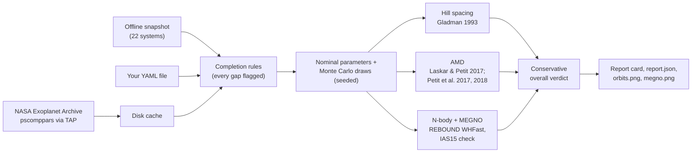

# exostab

**Is this planetary system dynamically stable? A fast, honest answer for any known multi-planet system,
with every assumption shown.**

[](https://github.com/mimitoz62/exostab/actions/workflows/ci.yml)
[](LICENSE)


exostab fetches a system's parameters from the [NASA Exoplanet Archive](https://exoplanetarchive.ipac.caltech.edu/),
fills gaps with explicit, logged rules, and runs three stability indicators:

1. **Hill spacing**: the Gladman (1993) two-planet criterion and a multi-planet spacing heuristic;
2. **Angular momentum deficit (AMD)**: Laskar & Petit (2017), with the resonance-overlap and Hill refinements of
   Petit, Laskar & Boué (2017, 2018);
3. **Direct N-body integration** with [REBOUND](https://github.com/hannorein/rebound) and the MEGNO chaos indicator,
   repeated over Monte Carlo draws within the published uncertainties and cross-checked with a second integrator.

It prints a report card, saves a JSON record of everything that went into the result, and plots the orbits and the
chaos indicator. When the indicators disagree, it says so instead of picking the most comfortable answer.

## Quickstart

```bash
pip install git+https://github.com/mimitoz62/exostab
exostab check "TRAPPIST-1"
exostab list --min-planets 4 --max-period-days 200
```

(`pip install exostab` will work once the first release is on PyPI.) Python 3.10 or newer. The first `check`
downloads the archive's multi-planet table once (about 10 s) and caches it; `--refresh` downloads it again and
`--offline` uses a bundled snapshot of 22 well-known systems.

## Commands

```bash
exostab check "Kepler-11"                                   # a system by host or planet name
exostab check "HD 127195" --orbits 100000 --draws 50 --seed 7 --out results/
exostab check --from-file examples/two_planet.yaml          # your own parameters (YAML)
exostab sweep "HD 127195" --planet b --param e --range 0 0.6 --steps 25
exostab list --min-planets 4 --max-period-days 200
exostab catalog build --limit 50                            # batch catalog: catalog.csv + catalog.parquet
exostab check "TRAPPIST-1" --budget thorough                # choose run length and draws for about 2 minutes
```

`check` writes `report.json`, `orbits.png` and `megno.png`; `sweep` writes `sweep.csv`, `sweep.png` and
`sweep.json`. Every run takes `--seed`, and the same seed gives the same draws. `exostab COMMAND --help` lists
all options.

## Web app

`pip install "exostab[web]"` and `streamlit run streamlit_app.py` start a browser version: search a system,
edit its parameters, try "what if" changes with sliders, choose a time budget, and download the report or a
shareable link to the exact run. See [docs/web.md](docs/web.md).

## Example report card

HD 127195 from the archive (offline snapshot of 2026-09-28, default settings):

```text
╭─────────────────────────── exostab 0.1.0.dev0 — stability report card ───────────────────────────╮
│ HD 127195   M* = 1.34 ± 0.06 M☉   2 planets   data: snapshot (2026-09-28)                        │
│                                                                                                  │
│ Planet       P (d)          Mass (M⊕)             e                 ω (deg)           Phase      │
│ HD 127195 b  534.5 ± 2.85   213 ± 6.36 (m sin i)  0.04 +0.05/−0.03  3.1 ± 1.97        random     │
│ HD 127195 c  836.99 ± 9.35  207 ± 6.36 (m sin i)  0.05 +0.05/−0.04  4.12 +1.21/−2.43  random     │
│ ᵃ assumed  ᵈ derived  ᵉ estimated  ʳ randomized per run  < upper limit                           │
│                                                                                                  │
│ Hill spacing    MARGINAL   draws: 16 stable, 0 marginal, 4 unstable                              │
│   Hill stable: separation 4.37 mutual Hill radii, above the Gladman (1993) limit of 3.44 for     │
│   circular orbits (eccentricities included in the test).                                         │
│   • The nominal parameters give 'stable', but the draws disagree.                                │
│ AMD             STABLE   draws: 19 stable, 0 marginal, 1 unstable                                │
│   AMD-stable: largest β = 0.204 (HD 127195 b / HD 127195 c), so collisions are excluded in the   │
│   secular approximation.                                                                         │
│   • Critical AMD from first-order resonance overlap (Petit et al. 2017) used for: HD 127195 b /  │
│   HD 127195 c.                                                                                   │
│ N-body + MEGNO  MARGINAL   draws: 13 stable, 6 marginal, 1 unstable                              │
│   Nominal run chaotic (<Y> = 9.82) over 14,634 yr (10,000 inner orbits); draws: 13 regular, 6    │
│   chaotic, 1 close encounter/escape of 20.                                                       │
│   • The orbital phases of HD 127195 b, HD 127195 c are not published and are drawn at random in  │
│   every run (the nominal run included). A system protected by a mean-motion resonance can look   │
│   chaotic or unstable for random phases; supply measured phases with --from-file to test the     │
│   real configuration.                                                                            │
│                                                                                                  │
│ Overall: MARGINAL  Mixed evidence: part of the parameter range allowed by the uncertainties is   │
│ chaotic or unstable, or the indicators disagree.                                                 │
│ N-body: 10,000 orbits of the innermost planet = 14,634 yr, WHFast dt = 16.4 d, checked with      │
│ IAS15; 20 Monte Carlo draws; seed 0; MEGNO chaotic at <Y> ≥ 2.2; energy-error limit 1e-05.       │
│                                                                                                  │
│ Data completion (applied automatically):                                                         │
│ b, c    Only the minimum mass m sin i is known; it is used as the mass (sin i = 1) unless        │
│         --inclination-prior is set.                                                              │
│ b, c    Orbital phase drawn uniformly for every run: no transit, conjunction or periastron time  │
│         is published.                                                                            │
│ system  All orbits are placed in one plane. Mutual inclinations are not published (sky-plane     │
│         inclinations do not determine them), and longitudes of the ascending node are not used.  │
│ Note: offline snapshot of 22 systems                                                             │
│                                                                                                  │
│ Saved: exostab-results/hd-127195/report.json, exostab-results/hd-127195/orbits.png,              │
│ exostab-results/hd-127195/megno.png                                                              │
╰──────────────────────────────────────────────────────────────────────────────────────────────────╯
```

The archive does not list orbital phases for HD 127195, so they are drawn at random, and some random phases are
chaotic. With the phases and uncertainties used in the HD 127195 Research Note
(`exostab check --from-file examples/hd127195_note.yaml --orbits 20000 --draws 200 --seed 42`), the best fit is
regular (⟨Y⟩ = 2.00) and 133 of 200 draws are regular, 62 chaotic and 5 have close encounters. The Note found
134 / 57 / 9.

## What the verdicts mean

| Verdict | Meaning |
|---|---|
| **stable** | The indicator's condition for stability holds for the nominal parameters and for at least 95% of the draws. |
| **marginal** | Borderline, or the draws within the uncertainties disagree with the nominal parameters. |
| **unstable** | The indicator predicts instability for the nominal parameters and for at least 95% of the draws. |
| **inconclusive** | The indicator could not be evaluated reliably (for example, the integration's energy error was too large). |

The **overall** verdict is conservative. It is *stable* only if all three indicators agree. It is *unstable* only
if the direct integration shows close encounters or escapes. Everything else is *marginal*. The Hill and AMD
criteria are *sufficient* conditions: failing them means stability is not guaranteed, not that the system falls
apart. GJ 876, for example, fails both, yet with its published orbital phases every N-body draw is regular. Its
three planets are locked in a resonance.

## How it works



Details, equations and references: [docs/methods.md](docs/methods.md). Data rules:
[docs/data-assumptions.md](docs/data-assumptions.md). Validation: [docs/validation.md](docs/validation.md).
Choices and their reasons: [DECISIONS.md](DECISIONS.md).

## Limitations

- **Finite horizon.** The default N-body run is 10,000 orbits of the innermost planet (41 years for TRAPPIST-1,
  14,600 years for HD 127195). "No chaos detected" over that span is not proof of stability over billions of years.
- **Coplanar orbits.** Mutual inclinations are almost never measured, so all orbits are placed in one plane.
- **Phases.** The archive's composite table mixes publications, and exostab uses a published phase only when it is
  safe to combine with the period. Otherwise it draws phases at random. Resonant systems can then look unstable,
  as GJ 876 does with archive data.
- **Independent draws.** Parameters are drawn independently from their error bars, ignoring the correlations in the
  published posteriors. This tends to overstate the fraction of unstable configurations.
- **Thresholds are judgment calls.** MEGNO ⟨Y⟩ ≥ 2.2 counts as chaotic, the energy-error limit is 10⁻⁵, and the
  multi-planet spacing threshold is 12 mutual Hill radii. Each is documented, with its uncertainty, in
  [DECISIONS.md](DECISIONS.md).
- **Not modelled.** Tides, general relativity, stellar evolution, companion stars and circumbinary planets.
  Circumbinary systems are rejected.
- **Estimated masses.** Many archive masses come from a mass–radius relation or are minimum masses (m sin i).
  Every such case is flagged in the report.

## Citing exostab

If you use exostab, please cite it using [CITATION.cff](CITATION.cff) (GitHub's "Cite this repository" button).
A Zenodo DOI will be added with the first release. Please also cite the methods the result relies on (see
[docs/references.bib](docs/references.bib)) and the NASA Exoplanet Archive.

## Acknowledgments

This research has made use of the NASA Exoplanet Archive, which is operated by the California Institute of
Technology, under contract with the National Aeronautics and Space Administration under the Exoplanet Exploration
Program. The archive asks users to cite Christiansen et al. (2025) and, for the Planetary Systems Composite
Parameters table, [doi:10.26133/NEA13](https://doi.org/10.26133/NEA13) with the access date. The archive date
of every run is stored in its `report.json`.

exostab is built on [REBOUND](https://github.com/hannorein/rebound) (Rein & Liu 2012) with WHFast (Rein & Tamayo
2015), IAS15 (Rein & Spiegel 2015) and its variational equations for MEGNO (Rein & Tamayo 2016), and on astropy,
astroquery, NumPy and Matplotlib. The AMD criteria are from Laskar & Petit (2017) and Petit, Laskar & Boué (2017,
2018). SPOCK (Tamayo et al. 2020) is planned as an optional fourth indicator.

## Related work

exostab grew out of the Research Note *N-body Stability Constraints on the Two Giant Planets of the Red Giant
HD 127195* (Öz 2026, submitted to Research Notes of the AAS) and its code,
[mimitoz62/hd127195-stability](https://github.com/mimitoz62/hd127195-stability).

## Contributing

Bug reports, requests for systems and new indicators are welcome: see [CONTRIBUTING.md](CONTRIBUTING.md) and the
issue templates. This project follows a [code of conduct](CODE_OF_CONDUCT.md).

## License

MIT. See [LICENSE](LICENSE). Author: Mehmet Öz ([ORCID 0009-0007-1005-7640](https://orcid.org/0009-0007-1005-7640)).
