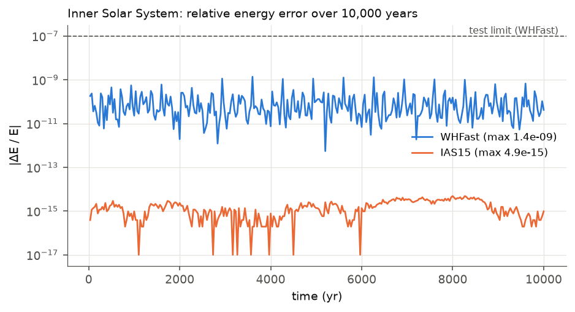
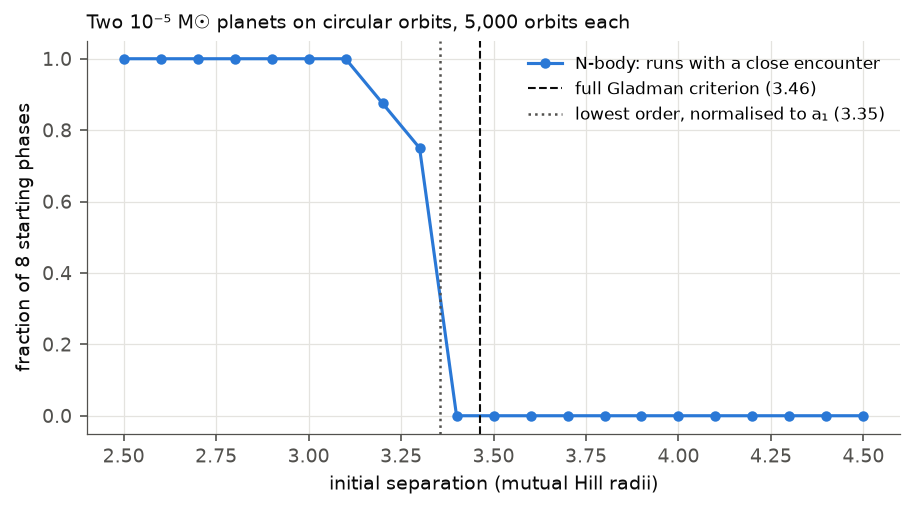
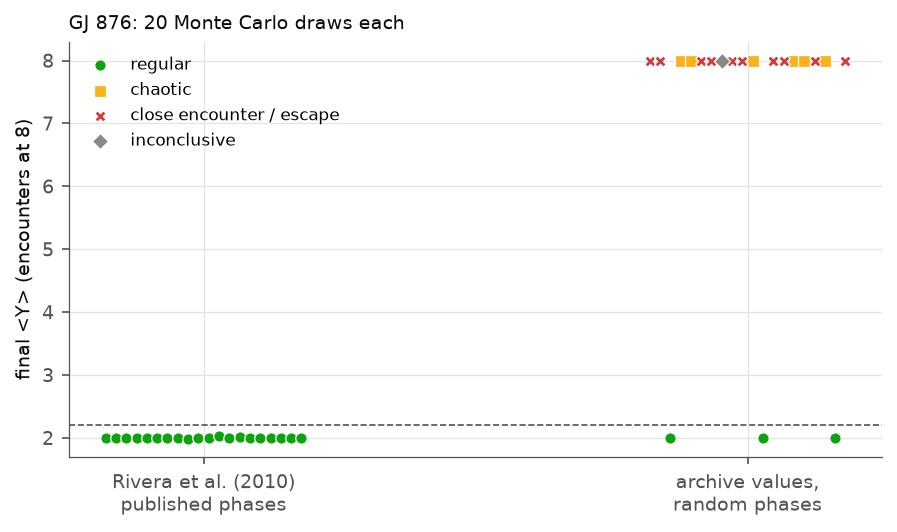
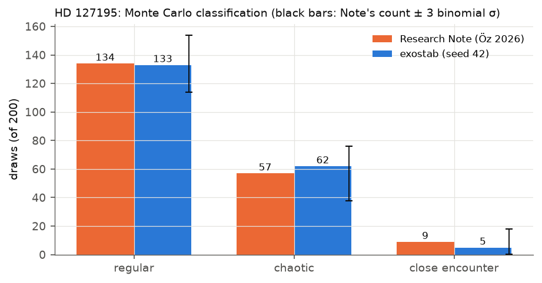

# Validation

The validation suite is in `tests/validation/test_validation.py`. It is slow (about a minute on a 14-core laptop),
so it runs nightly in continuous integration and on demand:

```bash
pytest -m slow
python scripts/validation_summary.py   # prints the numbers below
python scripts/validation_figures.py   # draws the figures below
```

(Run the two scripts from the repository root with `PYTHONPATH=.`.)

The numbers on this page were produced on 2026-09-28 by `scripts/validation_summary.py` with exostab 0.1.0.dev0,
REBOUND 5.2.0, NumPy 2.5.3 and Python 3.12.11 on macOS (Apple M4 Pro). They use the bundled archive snapshot of
2026-09-28 and default settings unless stated. Chaotic integrations are sensitive to floating-point rounding, so
counts of chaotic draws can differ by one or two on other machines. The tests allow for this.

## 1. Energy conservation: inner Solar System

Sun, Mercury, Venus, Earth–Moon, Mars (approximate J2000 elements, coplanar), integrated for 10,000 years.

| Integrator | Relative energy error | ⟨Y⟩ | Test tolerance |
|---|---|---|---|
| WHFast, dt = 1.89 d | 1.4 × 10⁻⁹ | 1.999 | < 10⁻⁷ |
| IAS15 | 4.9 × 10⁻¹⁵ | 2.001 | < 10⁻¹² |



## 2. The Hill limit

- For two planets of 10⁻⁵ M☉ around a solar-mass star on circular orbits, exostab's Gladman criterion gives
  3.462 mutual Hill radii. The circular-orbit limit tends to 2√3 = 3.464 for small masses.
- Reproducing notebook 02 of the Research Note code: from 8 starting phases, close encounters happen in every
  run at 2.5 and 3.0 mutual Hill radii and in none at 4.0 and 4.5 (5,000 orbits each). The Note's notebook
  found encounters stop between 3.30 and 3.35.
- A synthetic pair 2.5 mutual Hill radii apart gets the overall verdict **unstable** (Hill and N-body both
  unstable).



With a finer grid than the tests use, encounters happen in 75% of the runs at 3.3 and in none at 3.4 mutual
Hill radii, matching the Note's 3.30–3.35.

## 3. Known systems

| System | Data | Hill | AMD | N-body | Overall | Nominal ⟨Y⟩ (WHFast / IAS15) | Draws: regular / chaotic / encounter |
|---|---|---|---|---|---|---|---|
| TRAPPIST-1 | archive snapshot | marginal | stable | marginal | **marginal** | 2.171 / 2.169 | 18 / 2 / 0 |
| GJ 876 | Rivera et al. (2010) coplanar fit | unstable | marginal | stable | **marginal** | 1.993 / 1.995 | 20 / 0 / 0 |
| GJ 876 | archive snapshot (random phases) | unstable | marginal | marginal | **marginal** | 3.980 / 3.762 | 3 / 6 / 10 (1 inconclusive) |
| Kepler-11 | archive snapshot | marginal | marginal | marginal | **marginal** | 1.786 / 1.786 | 10 / 8 / 2 |

What the tests require (from the project brief) and why:

- **TRAPPIST-1**, a resonant chain: stable or marginal, never unstable. ✔
- **GJ 876**, in a Laplace resonance: expected stable. The archive does not provide usable orbital phases for
  GJ 876, and with random phases the resonance is destroyed (10 of 20 draws have close encounters). The test
  therefore uses the published four-planet solution of Rivera et al. (2010, Table 3), with its mean anomalies,
  and requires the **N-body** verdict to be stable ✔. The Hill and AMD criteria are only sufficient conditions,
  and they fail for this resonance-protected system. By design, the conservative overall verdict is therefore
  marginal, not stable.
- **Kepler-11**, a compact six-planet system: expected stable over the test horizon. The published configuration
  (archive values, phases from the transit times) is regular with both integrators over 10,000 orbits of
  Kepler-11 b (282 years), and nothing is unstable ✔. Across the Monte Carlo draws, 2 of 20 have close
  encounters. The archive's eccentricity error bars are wide (e.g. e_b = 0.045 +0.068), and independent draws
  sometimes make neighbouring orbits nearly cross. The N-body verdict is therefore marginal. This is reported as
  found.



## 4. The HD 127195 Research Note

`examples/hd127195_note.yaml` holds the Note's inputs. The run uses the Note's settings: 20,000 orbits of
planet b, 200 draws, WHFast at P_b/30 and MEGNO < 2.2 regular; seed 42.

| Quantity | Research Note | exostab | Test tolerance |
|---|---|---|---|
| a_b, a_c (AU) | 1.42125, 1.91684 | 1.42125, 1.91684 | 10⁻⁵ relative |
| Period ratio | 1.566 | 1.566 | 10⁻⁵ relative |
| Separation (mutual Hill radii) | 4.37 | 4.37 | 10⁻³ relative |
| Best-fit ⟨Y⟩, WHFast / IAS15 | 2.000 / 2.000 | 1.999 / 1.999 | ± 0.02 |
| Draws regular | 134 / 200 | 133 / 200 | ± 3 binomial σ (± 20) |
| Draws with close encounters | 9 / 200 | 5 / 200 | ± 3 binomial σ (± 9) |
| Draws chaotic, no encounter | 57 / 200 | 62 / 200 | (follows from the two above) |
| Draws passing the collision AMD test | 200 / 200 | 200 / 200 | all |
| AMD limit, equal eccentricities | 0.148 | 0.1478 | ± 0.0005 |
| Conclusion | best fit regular; a substantial part of the AMD-stable parameter space is chaotic | N-body: nominal stable, verdict marginal; overall marginal | exact |



The draws cannot match the Note one-to-one because the random number streams differ; the fractions agree within
the statistical tolerance. exostab's AMD verdict for these inputs is *marginal*, not *stable*. exostab also
applies the resonance-overlap refinement of Petit, Laskar & Boué (2017), which the Note did not use: the pair is
close enough (α = 0.742 above α_R = 0.728) for it to apply.

## 5. Reproducibility

The same seed gives identical runs (tested). Each `report.json` stores the seed, the versions of exostab, REBOUND,
NumPy, astropy and Python, the integrator and time step, the run length and the archive download date.
